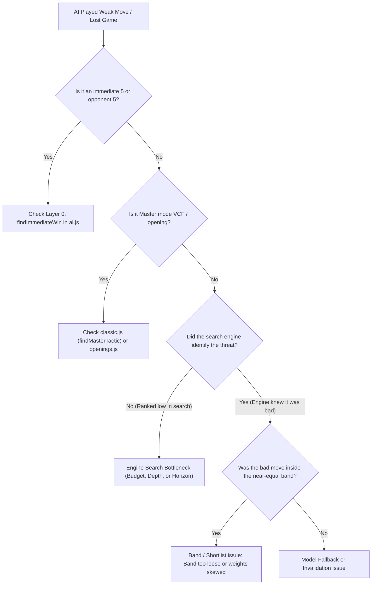

# Gomoku AI Playing Strength & Cost-Performance Tuning Runbook

This skill provides step-by-step procedures for diagnosing AI gameplay issues, tuning search and model parameters, and maintaining compliance with Cloudflare Workers CPU and token budgets.

---

## 1. Diagnostic Workflow: Identifying Strength Bottlenecks

When an AI move appears sub-optimal or an unexpected loss occurs, determine which layer failed:



### Diagnostic Steps
1. **Check Move Source (`source`)**:
   - `rule`: Played by immediate win/block detector ($O(1)$).
   - `classic`: Played by Master VCF, four-three, or opening book.
   - `search`: Engine move (used when model fails, times out, or when only 1 candidate survives the band).
   - `clef` / `jev`: Chosen by the AI model from the near-equal shortlist.
   - `local`: Random nearby fallback (indicates engine aborted or board had no candidates).
2. **Inspect Search Depth & Nodes**:
   - Check `depth` and `nodes` returned in the API response or debug logs.
   - If `depth < 6` on Paid plan, check if `nodeBudget` was cut off early (`nodes > nodeBudget * 0.45`).
   - If tactical threat was missed 4 plies ahead, check if `extensionLimit` was exhausted.
3. **Inspect Candidate Band**:
   - Look at `ranked[0].score` vs `ranked[i].score`.
   - If a move with a -5,000 score was offered to the model, verify why `band.absolute` (default 300) or `band.relative` (default 20%) did not prune it.

---

## 2. Tuning Procedures & Parameter Recipes

### Recipe A: Optimizing for Cloudflare Free Plan (10ms CPU Ceiling)
*Objective: Eliminate Cloudflare Error 1102 while maximizing tactical strength.*

1. Open [`src/lib/jev/move.js`](file:///Users/mo/dev/gomoku-ai-jev/src/lib/jev/move.js).
2. Inspect `PLAN_BUDGETS.free`:
   ```javascript
   export const PLAN_BUDGETS = {
     free: { search: 3_000, runoff: 1_500 },
     paid: { search: 220_000, runoff: 160_000 },
   };
   ```
3. Calculate maximum allowable budget:
   $$\text{Max Nodes} \approx \frac{10\,\text{ms} - 1.5\,\text{ms (overhead)}}{1.7\,\mu\text{s/node}} \approx 5,000\,\text{nodes}$$
   - Set `search: 3_000` to `3_500`.
   - Set `runoff: 1_200` to `1_500`.
4. In [`src/lib/jev/move.js`](file:///Users/mo/dev/gomoku-ai-jev/src/lib/jev/move.js), reduce `shortlist` on Hard from 8 to 6 to minimize candidate evaluation and prompt serialization overhead.
5. In [`wrangler.jsonc`](file:///Users/mo/dev/gomoku-ai-jev/wrangler.jsonc), ensure `WORKERS_PLAN` is `"free"`.
6. Run validation:
   ```sh
   node --test tests/jev.test.js
   ```

---

### Recipe B: Paid Plan Tournament Strength (Grandmaster Level)
*Objective: Maximize lookahead (8–12 plies) and tactical accuracy for competitive play.*

1. In [`src/lib/jev/move.js`](file:///Users/mo/dev/gomoku-ai-jev/src/lib/jev/move.js):
   - Increase `PLAN_BUDGETS.paid.search` to `350_000`.
   - Increase `PLAN_BUDGETS.paid.runoff` to `200_000`.
   - Tighten `band` to `{ absolute: 250, relative: 0.15 }` so only moves with near-zero score gap are given to the model.
   - Adjust `runoff` sensitivity in `LEVELS.hard` and `LEVELS.master`:
     ```javascript
     runoff: {
       search: { maxDepth: 12, width: 8, extensionLimit: 12 },
       confidence: 0.7, // Trigger runoff more readily on uncertain choices
       margin: 0.15,
     }
     ```
2. In [`src/lib/ai.js`](file:///Users/mo/dev/gomoku-ai-jev/src/lib/ai.js):
   - Increase `DIFFICULTY.hard.maxDepth` to `10`.
   - Increase `DIFFICULTY.hard.extensionLimit` to `10`.
3. In [`wrangler.jsonc`](file:///Users/mo/dev/gomoku-ai-jev/wrangler.jsonc):
   - Set `"WORKERS_PLAN": "paid"`.
4. Model selection: Use `@cf/cloudflare/clef` or `typesafe/jev-1.14.0`.

---

### Recipe C: Ultra-Low Latency Mode (Real-Time Blitz)
*Objective: Sub-300ms turn latency for responsive mobile/casual gameplay.*

1. In [`src/lib/jev/move.js`](file:///Users/mo/dev/gomoku-ai-jev/src/lib/jev/move.js):
   - Set `runoff: null` in `LEVELS.hard` (bypasses second-round model call).
   - Set `shortlist: 5` (reduces prompt tokens by ~40%).
2. In [`src/lib/workers-ai/ask.js`](file:///Users/mo/dev/gomoku-ai-jev/src/lib/workers-ai/ask.js):
   - Set `clefModel(difficulty)` to always return `clef-flash` (`@cf/cloudflare/clef-flash`).
   - Set `timeout: 2500` (drops stalled inference immediately to search engine).
3. In [`src/lib/ai.js`](file:///Users/mo/dev/gomoku-ai-jev/src/lib/ai.js):
   - Set `width: 8` (narrows search tree for rapid alpha-beta cutoffs).

---

### Recipe D: Defensive vs Aggressive Playstyle Tuning
*Objective: Tailor the AI's personality.*

1. Open [`src/lib/ai.js`](file:///Users/mo/dev/gomoku-ai-jev/src/lib/ai.js) and find `evaluateBoard` / `staticScore`:
   ```javascript
   function staticScore(root) {
     const own = root === BLACK ? scoreBlack : scoreWhite;
     const other = root === BLACK ? scoreWhite : scoreBlack;
     return own - other * 1.1; // 1.1 = defensive multiplier
   }
   ```
2. **Iron Defense / Counter-Puncher**:
   - Change multiplier from `1.1` to `1.25`.
   - In `generateMoves`: Change `against * 0.9` to `against * 1.15`.
   - Result: AI prioritizes blocking opponent two-in-a-row and three-in-a-row over creating its own attacks.
3. **Aggressive Swashbuckler**:
   - Change multiplier to `0.95`.
   - Result: AI actively races to build continuous threats (fours and open threes), ignoring non-lethal opponent structures.

---

## 3. Cost & Latency Estimation Formulas

Use these formulas when planning parameter modifications:

### 1. CPU Execution Time
$$\text{CPU Time (ms)} \approx \frac{\text{Nodes Explored}}{588} \approx \text{Nodes} \times 0.0017\,\text{ms}$$
- 3,000 nodes $\approx 5.1\,\text{ms}$
- 50,000 nodes $\approx 85\,\text{ms}$
- 220,000 nodes $\approx 374\,\text{ms}$

### 2. Request Token Size
$$\text{Prompt Tokens} \approx 250 + (\text{Move Count} \times 8) + (\text{Shortlist Size} \times 120)$$
- Early game (Move 10, Shortlist 8): $\approx 250 + 80 + 960 = 1,290$ tokens.
- Mid game (Move 30, Shortlist 12): $\approx 250 + 240 + 1,440 = 1,930$ tokens.

### 3. Model Inference Latency & Runoff Multiplier
- **Single Round Turn**: $\text{Search CPU} + \text{Model Latency (120–400ms)}$.
- **Runoff Turn (2 Rounds)**: $\text{Search CPU} + \text{Model Round 1} + \text{Runoff Search CPU} + \text{Model Round 2}$.
- *Runoff Probability*: Controlled by `runoff.confidence` (default 0.6) and `runoff.margin` (default 0.1). Typically triggers in 20–25% of moves.

---

## 4. Verification & Benchmarking Checklist

Whenever parameters are adjusted:

1. **Syntax & Unit Test Verification**:
   ```sh
   node --test
   ```
2. **Search Performance Verification**:
   ```sh
   node --test tests/ai.test.js
   ```
   Check that `honours the node budget` and `hard tactics` pass cleanly.
3. **Free Plan Boundary Verification**:
   ```sh
   node --test tests/jev.test.js
   ```
   Ensure `keeps a free-plan hard turn inside the free budgets` stays within limits.
4. **API Contract Verification**:
   ```sh
   node --test tests/move-api.test.js
   ```
   Ensure response formats (`rounds`, `depth`, `model`, `confidence`) remain intact.
