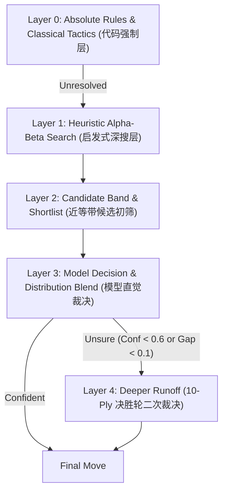

# Gomoku AI — Clef & Jev

A browser-based Gomoku (five-in-a-row) game. The Worker searches the position and Clef or Jev chooses among the moves the search cannot separate. Clef is the default opponent, and Hard is the default difficulty. The site is an Astro app deployed to Cloudflare Workers.

**Live demo:** https://gomoku.games.interjc.net/

## Features

- **15×15 board** with canvas rendering (wooden board, gradient stones)
- **Player vs AI** — play as black or white
- **Clef / Jev toggle in the title** — `/clef` and `/jev` identify the opponent; switching paths reloads the page and starts a new game
- **Compact opponent status** — the navbar shows the current model and difficulty; hover for details, or click/tap to open a modal with the model name and search strength. Model names are Clef, Clef Flash, and Jev, without transport IDs or provider details.
- **4 difficulty levels** — difficulty is how far ahead the AI looks and tactical depth:
  - Easy: no lookahead at all. The model picks from nearby points described by the current position alone — no scores, no replies
  - Medium: a depth-2 search shortlists a dozen points, and the model picks among them with the pattern score and the opponent's best answer
  - Hard: iterative deepening to 8 plies with threat extension, then the model chooses among the near-equal candidates using the verified line behind each one, with a deeper second round when it is torn between the top two
  - Master: hard's deep search augmented with classical Gomoku tactics (four-threes, continuous fours / VCF, jump fours) and an opening book of the 26 canonical Gomoku openings (Flower moon, etc.)
- **Win detection** — horizontal, vertical, both diagonals, with winning stone line highlight
- **Undo** — rewind the last 2 moves (yours + AI's)
- **Move history** panel with algebraic notation
- **AI thinking indicator** with async rendering
- **English / Japanese / Chinese UI** with dropdown switcher (defaults to English)
- **Persistent preferences & shareable URLs** — language, theme, difficulty, and player side persist in `localStorage` and can be set via URL parameters (`?lang=`, `?theme=`, `?difficulty=`, `?color=`)
- **Dark / light theme**
- **Mobile-friendly** — touch support on canvas, responsive layout

## Providers & Configuration

Both providers are enabled by default. The deployment default is **Clef**, while **Hard** is the default difficulty for visitors without a saved or URL-specified difficulty. The title links to `/jev` and `/clef`. Choosing the other opponent performs a full navigation and starts a fresh game; difficulty, side, language, and theme retain their existing URL/localStorage behavior. Switching preserves query parameters and the hash. The provider itself is specified by the path, rather than a query parameter or localStorage.

The root `/` redirects to the configured default opponent. A disabled or unconfigured opponent redirects to the available default. If neither provider is available, `/` serves a local-engine game and disables both toggle options. Unknown opponent paths return 404. Pages read deployment configuration at request time and are not cached.

### Wrangler switches

```jsonc
{
  "ai": {
    "binding": "AI",
    "remote": true
  },
  "vars": {
    "WORKERS_PLAN": "free",
    "AI_CLEF_ENABLED": "true",
    "AI_JEV_ENABLED": "true",
    "AI_DEFAULT_PROVIDER": "clef",
    "CLEF_MIN_CONFIDENCE": "0",
    "CLEF_TIMEOUT_MS": "6000",
    "JEV_MIN_CONFIDENCE": "0"
  }
}
```

`AI_CLEF_ENABLED` and `AI_JEV_ENABLED` independently enable each opponent; set either to `"false"` to disable it. `AI_DEFAULT_PROVIDER` accepts `"jev"` or `"clef"`. Both providers require the `AI` binding; neither requires a TypeSafe API key. If the configured default is unavailable, the available opponent becomes the default. Explicit move requests for an unknown, disabled, or unconfigured provider return HTTP 400.

`WORKERS_PLAN` is `"free"` or `"paid"` and sets the hard and master search budgets to fit that plan's CPU limit. See [Workers Free and Paid plans](docs/workers-plans.md).

### Clef through Workers AI

The [Workers AI binding](https://developers.cloudflare.com/workers-ai/configuration/bindings/) calls the two [Clef models](https://developers.cloudflare.com/workers-ai/models/clef/) using the same System One decision format as Jev:

| Difficulty | Model ID | Request selector |
|------------|----------|------------------|
| Easy | `@cf/cloudflare/clef-flash` | `clef-flash` |
| Medium | `@cf/cloudflare/clef-flash` | `clef-flash` |
| Hard (default) | `@cf/cloudflare/clef-flash` | `clef-flash` |
| Master | `@cf/cloudflare/clef` | `clef` |

Both rounds of a hard/master decision use the same model. No TypeSafe key or separate Cloudflare inference key is needed for the AI binding. For development, log in with `pnpm exec wrangler login`. The Worker runs locally, but `remote: true` sends inference to Cloudflare; these calls consume real Workers AI usage. See [remote bindings](https://developers.cloudflare.com/workers/local-development/#remote-bindings) and [Clef Flash](https://developers.cloudflare.com/workers-ai/models/clef-flash/).

`CLEF_MIN_CONFIDENCE` sets the acceptance floor (0–1). `CLEF_TIMEOUT_MS` bounds each model call, with no automatic retry. The timeout stops waiting for the result; it does not guarantee cancellation of inference already running remotely. On failure, timeout, or an invalid answer, the Worker uses its existing search fallback. A failed second round keeps the valid first-round decision. It does not automatically call the other provider.

### Jev through Cloudflare

Jev uses the same `AI` binding as Clef with the fixed model ID [`typesafe/jev-1.14.0`](https://developers.cloudflare.com/ai/models/typesafe/jev/). Its request contains `state` and the typed `move` question. Both rounds use Jev, with a six-second timeout per call and no automatic retry. Responses use the same choice and probability validation as Clef.

`JEV_MIN_CONFIDENCE` retains the Jev acceptance floor. The TypeSafe SDK, API key, custom endpoint, and model environment settings are no longer used. Local settings may override public Wrangler variables in `.dev.vars`, for example:

```ini
AI_DEFAULT_PROVIDER=clef
# JEV_MIN_CONFIDENCE=0
```

If the AI binding is unavailable, both title options are disabled. If a configured model call fails, the game continues with the built-in engine. The details modal explains unavailable options and describes the selected search profile; it is not an Elo rating or a guarantee that every turn requires a model call.

## Development

### Prerequisites

- **Node.js**: `>= 24.0.0` (required for native `node:test`)
- **pnpm**: Package manager

### Getting Started

1. **Install dependencies**:
   ```sh
   pnpm install
   ```

2. **Configure environment variables**:
   Run `pnpm exec wrangler login` for remote Cloudflare inference with Clef and Jev. Optionally copy `.dev.vars.example` to `.dev.vars` to override public settings (see [Providers & Configuration](#providers--configuration)).

3. **Start the local server**:
   ```sh
   pnpm run dev
   ```
   *(Alternatively, run `bash scripts/dev.sh`)*

   The dev server will start at `http://localhost:4321`.

4. **Run tests**:
   ```sh
   pnpm test
   ```
   *(Tests use Node.js built-in `node:test` runner).*

5. **Build and preview**:
   ```sh
   pnpm run build
   pnpm run preview
   ```

## Deploy

The production target is a Cloudflare Worker using `@astrojs/cloudflare` as the adapter entry. The Worker has a remote Workers AI binding and no KV, D1, or R2 bindings.

### Deploying with Wrangler CLI

1. **Log in to Cloudflare**:
   ```sh
   pnpm exec wrangler login
   ```

2. **Build and deploy**:
   ```sh
   pnpm run deploy
   ```
   *(Runs `astro build && wrangler deploy`).*

The Worker name is `gomoku-ai-jev`. On the first deployment, it will be available on your `*.workers.dev` subdomain. You can attach a custom domain in the Cloudflare dashboard under **Workers & Pages > Settings > Domains & Routes**.

### Cloudflare Workers Builds (CI/CD)

When using Git integration via Cloudflare Workers Builds:
- **Build command**: `pnpm run build`
- **Deploy command**: `pnpm exec wrangler deploy`
- **AI binding**: Clef and Jev both use the `AI` binding configured in `wrangler.jsonc`; no TypeSafe secret is required.
- **Public variables**: Defined in `wrangler.jsonc` and deployed automatically.

## Model decisions

Clef and Jev share the same request builder, search shortlist, blending, and runoff. The provider adapter returns `{ choice, confidence, probabilities }`. Both use `env.AI.run()` through Cloudflare.

[Jev](https://docs.typesafe.ai/introduction) is TypeSafe's flagship System One model. It does not write a reply or search a game tree. A program sends the current facts as `state` and asks a typed question. Jev returns a structured answer the program can branch on.

Each model decision sends the selected provider the board and the full move list in `history`. The question is one [Choice](https://docs.typesafe.ai/primitives/choice) over a **shortlist** of empty points, not every nearby cell. The shortlist is what makes the difficulty ladder:

| Level | Points offered | What each point carries |
|-------|----------------|-------------------------|
| Easy | 24 nearby | adjacency only: neighbouring stones, whether it touches the latest stone |
| Medium | top 12 by depth-2 search | pattern made, forcing threats, score after the opponent's best reply |
| Hard | the near-equal band, at most 8 | the above plus the verified `best_line`, `score_behind_best`, `searched_plies`, `wins_by_force`, `loses_by_force` |
| Master | the near-equal band, up to 12 | the above plus `classic` shape classification (fours, four-three, double-three), opening book match (`book_move`, `book_opening`), and opening context |

Medium, hard, and master also attach the original pattern weights: five 100000, open four 10000, closed four 1000, open three 1000, closed three 100, open two 100, with defense counted as `opponentScore × 1.1`.

Two things keep hard and master strong:
1. The **band** contains only the moves whose deep search scores sit within one closed three of the best (within 300 points or 20% margin), with forced losses dropped and a forced win played outright — so the model selects only within the search’s near-equal band.
2. The answer is read as a **distribution**: `probabilities` is blended 50/50 with the normalised search ranking rather than taking the single top label. The same blending rules apply to both providers; model confidence is not a measure of chess strength.

When the model's confidence is under 0.6, or the blend leaves the top two within 0.1, hard and master re-search just those two points to 10 plies and ask again — a runoff on better information. That is at most two calls per turn.

An immediate five, or a block of the opponent's immediate five, is still played in code above easy. On Master, unambiguous classical winning tactics (continuous fours / VCF, four-threes) and jump-four blocks are played directly without asking the model. If the request fails, the point is illegal, or it falls outside the band, the Worker returns its own search move.

The Worker calls Jev as `typesafe/jev-1.14.0` through the [Cloudflare AI binding](https://developers.cloudflare.com/ai/models/typesafe/jev/).

## How the AI Works

Each model-backed AI turn asks `POST /api/move` on the Worker with an explicit `provider` (`clef` or `jev`), the board, player, difficulty, and history. Responses retain row/column, confidence, depth, and rounds. `model` is `Clef`, `Clef Flash`, or `Jev` when a model supplied the decision, and `null` for an engine move. Responses do not include a provider field or transport model ID. `source` distinguishes `clef`, `jev`, `search`, `rule`, `classic`, and `local`.

The API accepts only Gomoku positions, without an AI classification step:

- Requests must use `application/json` and fit within **16 KiB**. The limit is enforced while reading the body, even without a trustworthy `Content-Length`. Unsupported content types return 415; oversized bodies return 413.
- Only `board`, `player`, `history`, `difficulty`, and `provider` are accepted. `board`, `player`, and the complete `history` are required. Difficulty defaults to hard and provider defaults to the available deployment default; supplied values must be valid enum values. Prompt, messages, model, state, instructions, and all other extra fields return 400.
- The board must be a 15 × 15 numeric matrix of 0 (empty), 1 (black), or 2 (white). Each history entry contains only numeric `row`, `col`, and `player`. The server replays from an empty board, checks black-first alternating turns, integer coordinates, unique points, and exact agreement with the supplied board. The requested player must be next to move.
- Won games, moves after a win, full boards, missing or inconsistent records, and malformed JSON return 400 before search or inference.
- Cloudflare model IDs are fixed to `@cf/cloudflare/clef`, `@cf/cloudflare/clef-flash`, and `typesafe/jev-1.14.0`. Clients cannot supply a model ID, endpoint, instructions, or candidate descriptions. The server generates the model request from the validated game.

This verifies that input is a legal Gomoku record. It cannot prove that the record came from a human playing on this site, and does not rate-limit repeated legal game requests.

1. **Rule & Tactical shortcuts**: Above easy, code plays an immediate five or blocks the opponent's immediate five. On Master, code also checks classical tactical shapes (continuous fours / VCF, four-threes, jump-four blocks) and plays them directly.
2. **Search**: The engine searches to the depth the level allows and ranks every candidate point. On Master in a recognized opening, the search restricts root moves to the recorded canonical branches.
3. **Model Choice & Blending**: The selected model chooses among the shortlist. On hard and master the pick is blended 50/50 with the search ranking, and an unsure answer triggers the deeper runoff round (10 plies).
4. **Fallback**: A failed request, an illegal point, a pick outside the band, or confidence below the provider’s configured acceptance floor falls back to the search's own best move, which the Worker already has in hand. The default threshold is `0`.

The page searches for itself when the Worker is unreachable (offline fallback), or when neither provider is available, and then at reduced limits (depth 6, 60 000 node budget on hard and master) — a full deep search does not belong on the browser's main thread.

### Board evaluation

The evaluation function scans every row, column, and diagonal for consecutive stones and scores each pattern:

| Pattern | Score |
|---------|-------|
| Five in a row | 100 000 (win) |
| Open four | 10 000 |
| Closed four | 1 000 |
| Open three | 1 000 |
| Closed three | 100 |
| Open two | 100 |

The final score is `ownScore - opponentScore × 1.1` (slightly defensive).

### Classical shapes and opening book (Master)

The alpha-beta evaluator evaluates runs of consecutive stones. To bridge tactical gaps that simple consecutive-run scoring misses until depth expands:
- **Sliding-window shapes**: A length-5 window directly identifies jump fours (`XX.XX`), four-threes, and double-threes.
- **Victory by Continuous Fours (VCF)**: A dedicated tactical search resolves forced winning four-sequences before calling minimax or the model.
- **26 Canonical Gomoku Openings**: All 26 classical opening patterns (Direct openings like Flower Moon / 花月, Stream Moon / 溪月, etc., and Indirect openings like Po Moon / 浦月, Silver Moon / 银月, etc.) are recognized under all 8 symmetries (rotations and reflections). When an opening matches, the engine guides both root move selection and the state presented to the model.

### The search

Alpha-beta over a fixed root perspective, so every score still reads as "good for the AI" the way the original minimax did. Four things buy the depth:

- **Incremental evaluation.** The search keeps a running pattern score per player. Placing a stone rescores only the four lines through that cell, so a leaf evaluation is a subtraction instead of a 225-cell board scan.
- **Cheap move ordering.** Candidates are ranked by what the point gains the mover and denies the opponent, measured locally around the cell. One walk per direction serves both players.
- **Narrowing width.** The root keeps 12 candidates for a trustworthy ranking; deeper plies keep 8, then 5, and beyond ply 1 only points adjacent to a stone.
- **Forced-move collapsing and threat extension.** When a five is available the node is cut to that single move, or to the points that must be occupied. A four or an open three extends the line past the nominal depth, which is what stops horizon blunders.

Depth is bounded by a **node budget**, not a clock: on Cloudflare Workers `Date.now()` does not advance during pure computation, so a time budget would never fire. On the Paid plan, Hard and Master reach 6–8 plies (further along forcing lines) in roughly 300–450 ms. On the Free plan, smaller budgets keep each move within 10 ms of CPU and reach 2–4 plies. See [Workers Free and Paid plans](docs/workers-plans.md).

Root moves are searched on a full window rather than a raised alpha. That costs pruning, but the point of the root pass is a trustworthy *ranking* for the model to read, and alpha raising would turn every non-best score into an upper bound.

For reference, the previous depth-4 engine re-evaluated the whole board for every candidate at every node, and took 29–49 seconds per move on the same positions.

## AI Strength Tuning, Performance & Cost (棋力调参、性能与成本)

The AI combines a classical tactical evaluator, an iterative-deepening alpha-beta search, and a Cloudflare Workers AI System One model (Clef / Jev). Adjusting its playing strength requires balancing search depth, candidate filtering, model tier, and compute/cost budgets across Cloudflare's runtime limits.

### 1. Architectural Layers & Tuning Levers (棋力分层调参体系)

Gomoku playing strength is controlled across four distinct layers:



1. **Layer 0: Absolute Rules & Classical Shapes (`src/lib/classic.js`)**
   - **Immediate win / block**: Five-in-a-row and blocking opponent five are resolved immediately in code ($O(1)$) above Easy.
   - **VCF (Victory by Continuous Fours)**: On Master, continuous four attack chains are solved via depth-first threat search before minimax or model calls.
   - **Canonical Openings (26 开局库)**: Master recognizes canonical openings (Flower Moon / 花月, Po Moon / 浦月, etc.) across 8 symmetries, locking root moves to standard winning branches.
   - *Impact*: Eliminates catastrophic tactical blunders; costs 0 CPU search nodes and 0 API tokens.
2. **Layer 1: Alpha-Beta Search Engine (`src/lib/ai.js`)**
   - **Node Budget (`nodeBudget`)**: Controls how many tree nodes may be explored before returning the deepest completed iterative pass.
   - **Search Width (`width`)**: Candidate branching factor at root and interior nodes (narrowed at plies 2, 4+).
   - **Threat Extension (`extensionLimit`)**: Extends search by +1 ply whenever a move creates an open three or a four, overcoming horizon effects.
   - **Evaluation Weights (`EVALUATION`)**: Consecutive stone scores (Five: 100,000, Open Four: 10,000, Closed Four: 1,000, Open Three: 1,000) with a 1.1 defensive multiplier (`ownScore - opponentScore * 1.1`).
3. **Layer 2: Shortlisting & Noise Band (`src/lib/jev/move.js`)**
   - **Shortlist Size (`shortlist`)**: Number of candidate moves presented to the model (Easy: 24, Medium: 12, Hard: 8, Master: 12).
   - **Near-Equal Noise Band (`band`)**: Moves must fall within `max(300, best * 0.2)` of the search's #1 move. If the search finds an overwhelming tactical move, only that move is offered.
   - *Impact*: Acts as a safety guardrail. The model is never permitted to play a tactically inferior move that the engine proved is a blunder.
4. **Layer 3: Model Blending & Runoff (`src/lib/jev/move.js`)**
   - **Blend Ratio (`SEARCH_WEIGHT: 0.5, JEV_WEIGHT: 0.5`)**: Combines normalized search scores with model choice probabilities.
   - **Runoff Thresholds (`runoff.confidence: 0.6, runoff.margin: 0.1`)**: If the model is torn or unconfident, re-searches the top 2 candidates to depth 10 and invokes a second model decision.

---

### 2. Parameter Tuning Matrix (核心调参矩阵)

| Category (分类) | Parameter (参数) | Location (位置) | Default (默认值) | Tuning Direction & Strength Impact (调参方向与棋力影响) | Performance & Latency (性能与延迟) | Cost & Resource Impact (成本与资源消耗) |
|---|---|---|---|---|---|---|
| **Search Budget** | `PLAN_BUDGETS.free.search` | `src/lib/jev/move.js` | `3_000` | Increasing to 5,000 deepens Free search (2 $\to$ 4 plies), improving tactical vision. | CPU time rises from ~5ms to ~8.5ms. **Critical risk of exceeding Cloudflare 10ms limit (Error 1102)**. | Free tier ($0). |
| **Search Budget** | `PLAN_BUDGETS.paid.search` | `src/lib/jev/move.js` | `220_000` | Increasing to 500,000 reaches 10–12 plies, catching deep tactical combinations. | CPU time increases from ~350ms to ~850ms per move. | Paid plan includes 30s CPU limit; no extra monetary cost. |
| **Search Budget** | `PLAN_BUDGETS.runoff` | `src/lib/jev/move.js` | `1_500` (Free) / `160_000` (Paid) | Sets budget for depth-10 runoff between top 2 moves. | Adds CPU time only when a turn triggers the runoff round. | Pure CPU compute. |
| **Search Tree** | `maxDepth` | `src/lib/ai.js` | 8 (Hard/Master), 10 (Runoff) | Upper bound on iterative deepening plies. Higher values allow deeper lookahead if budget permits. | Increases recursion depth; bounded by `nodeBudget`. | No API cost. |
| **Search Tree** | `width` | `src/lib/ai.js` | 12 (Hard/Master) | Narrowing (e.g. 8) accelerates deeper search along principal lines; widening (e.g. 16) avoids missing flank tactics. | Exponential node growth $O(W^D)$; narrower width reaches deeper plies within budget. | No API cost. |
| **Search Tree** | `extensionLimit` | `src/lib/ai.js` | 8 (Hard/Master) | Extends search plies on forcing moves (fours/open threes). Higher values completely prevent horizon blunders. | Causes more nodes to be explored in highly volatile tactical skirmishes. | No API cost. |
| **Evaluation** | Defensive multiplier | `src/lib/ai.js` | `1.1` | $>1.2$ makes AI overly conservative/defensive; $<1.0$ makes AI aggressive, risking missed opponent counter-attacks. | Zero runtime overhead. | No API cost. |
| **Candidate Band** | `band.absolute` / `band.relative` | `src/lib/jev/move.js` | `300` / `0.2` (20%) | Tightening (e.g. 150 / 0.1) forces strict engine play; widening (e.g. 500 / 0.3) grants LLM more strategic freedom but risks sub-optimal moves. | Zero latency impact. | Prevents LLM hallucinations from deteriorating game strength. |
| **Candidate List** | `shortlist` | `src/lib/jev/move.js` | 8 (Hard), 12 (Master), 24 (Easy) | Fewer candidates (6–8) focus model attention; more candidates (16+) dilute attention and increase prompt tokens. | Larger shortlists increase LLM Time-to-First-Token (TTFT) by ~50–150ms. | **Direct Token Cost**: Each candidate adds ~100–140 JSON tokens to prompt. |
| **Blending** | `SEARCH_WEIGHT` / `JEV_WEIGHT` | `src/lib/jev/move.js` | `0.5` / `0.5` | `0.7 / 0.3` favors engine tactical certainty; `0.3 / 0.7` favors LLM strategic intuition and shape harmony. | Zero computation overhead. | No API cost. |
| **Runoff Trigger** | `runoff.confidence` / `runoff.margin` | `src/lib/jev/move.js` | `0.6` / `0.1` | Higher thresholds (e.g. 0.8 / 0.2) trigger runoff more often, strengthening contested moves. | Runoff adds a second model round + depth-10 search (+300–800ms latency). | **Doubles API calls** for that turn (2 model inferences instead of 1). |
| **Model Selection** | `clefModel(difficulty)` | `src/lib/workers-ai/ask.js` | `clef-flash` (Hard), `clef` (Master) | `clef` has superior position judgment; `clef-flash` provides rapid, lightweight selection. | Flash responds in ~100–200ms; full Clef / Jev takes ~400–800ms. | Clef Flash uses minimal Workers AI quota; full Clef / Jev consumes more AI Gateway credits. |
| **Inference Safeguard** | `CLEF_TIMEOUT_MS` | `wrangler.jsonc` | `6000` | Shorter timeout (e.g. 2500ms) guarantees fast UI fallback to engine search if Cloudflare AI lags. | Limits worst-case turn delay for end users. | Timed-out remote requests may still count towards quota. |

---

### 3. The Three-Way Trade-off: Strength vs Performance vs Cost (棋力、性能与成本权衡)

#### A. Compute Costs & Cloudflare Workers Plan Limits
- **Node Execution Speed**: A search node on Cloudflare Workers V8 takes $\approx 1.7\,\mu\text{s}$.
- **Free Plan Limit (10 ms CPU)**:
  $$\text{Total CPU Time} \approx (N_{\text{search}} + N_{\text{runoff}}) \times 1.7\,\mu\text{s} + \text{Replay Validation (~1.5 ms)} \le 10\,\text{ms}$$
  The Free plan budget (`search: 3,000`, `runoff: 1,500`) keeps CPU usage around $7.5\,\text{ms}$, safely below the 10 ms kill limit. Raising `search` above 4,500 risks **Cloudflare Error 1102 (*Worker exceeded resource limits*)**, terminating user requests with HTTP 503.
- **Paid Plan Limit (30 s CPU)**:
  The Paid plan budget (`search: 220,000`, `runoff: 160,000`) consumes $\approx 370\,\text{ms}$ of CPU, searching 6–10 plies deep without any risk of resource limits.

#### B. Inference Cost & Token Efficiency
- Jev and Clef receive structured board data via `buildJevRequest()` in JSON format.
- **Prompt Token Formula**:
  $$\text{Tokens} \approx \underbrace{250}_{\text{Rules \& State}} + \underbrace{L_{\text{history}} \times 8}_{\text{Move History}} + \underbrace{N_{\text{candidates}} \times 120}_{\text{Criteria, Lines \& Shapes}}$$
- A shortlist of 8 candidates consumes $\approx 1,200\text{--}1,500$ tokens per call.
- A shortlist of 24 candidates consumes $\approx 3,000\text{--}3,500$ tokens, tripling inference latency and token consumption while diluting model attention.
- Hard and Master candidate pruning (`band`) actively reduces the number of candidates offered whenever the search engine finds clear tactical divergence, minimizing unnecessary token burn.

#### C. Runoff Economics: Two-Round Trade-offs
- In ~75% of positions, the model makes a confident choice ($\ge 0.6$) or the top move has a clear margin ($\ge 0.1$). This costs **1 model inference** and **1 search pass**.
- In ~25% of knife-edge positions, the runoff triggers:
  1. Top 2 moves are re-searched to depth 10 with `PLAN_BUDGETS.runoff`.
  2. A second model call is dispatched with refreshed lines.
- *Result*: Strengthens play exactly where it matters most, avoiding paying double latency and token costs on straightforward turns.

#### D. Browser Offline Fallback Constraints
- When the server is unreachable or offline, `src/scripts/main.js` falls back to `FALLBACK_LIMITS` (`maxDepth: 6`, `nodeBudget: 60_000`).
- Because client JavaScript runs on the browser's UI thread, searches cannot exceed 100,000 nodes without freezing canvas rendering and dropping frame rates.

---

### 4. Practical Tuning Presets (推荐调优方案)

#### Preset 1: Free Tier Ultra-Safe (免费版极致安全型)
*Goal: Maximum stability under Cloudflare Free 10ms CPU limit with zero Error 1102.*
- `WORKERS_PLAN="free"`
- `PLAN_BUDGETS.free = { search: 2_500, runoff: 1_200 }`
- `LEVELS.hard.shortlist = 6`
- `CLEF_TIMEOUT_MS = 4000`
- Model: `@cf/cloudflare/clef-flash`

#### Preset 2: Paid Tournament Master (付费版大师锦标赛型)
*Goal: Maximum playing strength, Grandmaster-level opening, deep 10-ply tactical foresight.*
- `WORKERS_PLAN="paid"`
- `PLAN_BUDGETS.paid = { search: 350_000, runoff: 250_000 }`
- `LEVELS.master.shortlist = 12`
- `LEVELS.master.runoff.confidence = 0.75` (frequent deeper re-verification)
- Model: `@cf/cloudflare/clef` or `typesafe/jev-1.14.0`

#### Preset 3: Low-Latency Real-Time Blitz (低延迟极速对弈型)
*Goal: Turn latency < 350ms for lightning-fast mobile play.*
- `PLAN_BUDGETS.paid = { search: 80_000, runoff: 40_000 }`
- `LEVELS.hard.runoff = null` (disable second-round runoff)
- `LEVELS.hard.shortlist = 5`
- Model: `@cf/cloudflare/clef-flash`
- `CLEF_TIMEOUT_MS = 2500`

---

## Project Structure

```
gomoku-ai-jev/
├── astro.config.mjs    Astro config, output server, @astrojs/cloudflare
├── wrangler.jsonc      AI binding, provider switches & public vars
├── docs/               Deployment notes (Workers Free vs Paid plans)
├── .dev.vars.example   Example local development environment variables
├── src/
│   ├── middleware.js   Disable caching for opponent pages and redirects
│   ├── components/
│   │   └── Game.astro   Shared page, opponent toggle & details dialog
│   ├── pages/
│   │   ├── index.astro Root redirect, or local-only game
│   │   ├── [provider].astro Runtime /clef and /jev routes
│   │   └── api/
│   │       └── move.js Server-side AI move endpoint (Cloudflare Worker)
│   ├── styles/
│   │   └── global.css  Layout, dark/light themes, responsive canvas
│   ├── scripts/
│   │   └── main.js     Client DOM, Canvas rendering, game loop & offline fallback
│   └── lib/
│       ├── gomoku.js   Board logic (immutable), win detection, nearby cells
│       ├── ai.js       Evaluation + iterative-deepening alpha-beta search
│       ├── classic.js  Classical shapes, four-three tactics, and VCF solver
│       ├── openings.js 26 canonical Gomoku opening records & symmetry mapping
│       ├── providers.js Provider configuration & transport selection
│       ├── move-api.js Gomoku-only request limits, replay validation & handler
│       ├── provider-choice.js Provider IDs & availability resolution
│       ├── workers-ai/
│       │   └── ask.js  Clef model mapping, AI binding, validation & timeout
│       ├── prefs.js    URL query parameters & localStorage preference handling
│       ├── i18n.js     English / Japanese / Chinese translations
│       └── jev/
│           ├── ask.js  Cloudflare Jev adapter & confidence configuration
│           └── move.js Shared request builder, candidate shortlisting & runoff
├── tests/
│   ├── gomoku.test.js  Board rules & win detection tests
│   ├── ai.test.js      Search depth, ordering, and tactics tests
│   ├── classic.test.js Classical tactics & opening recognition tests
│   ├── jev.test.js     Jev request builder, shortlist & runoff tests
│   ├── providers.test.js Provider switches, model transport & fallback tests
│   ├── move-api.test.js API input restrictions, legal records & model names
│   ├── prefs.test.js   Settings URL/localStorage sync tests
│   └── i18n.test.js    Localization key completeness tests
└── assets/             Screenshots and media
```

## License

MIT


## Links

- 🌐 Demo: https://gomoku.games.interjc.net/
- 🔑 TypeSafe AI Platform: https://api.typesafe.ai
- ☁️ [Cloudflare Clef](https://developers.cloudflare.com/workers-ai/models/clef/) / [Clef Flash](https://developers.cloudflare.com/workers-ai/models/clef-flash/)
- 📖 TypeSafe Documentation: https://docs.typesafe.ai
